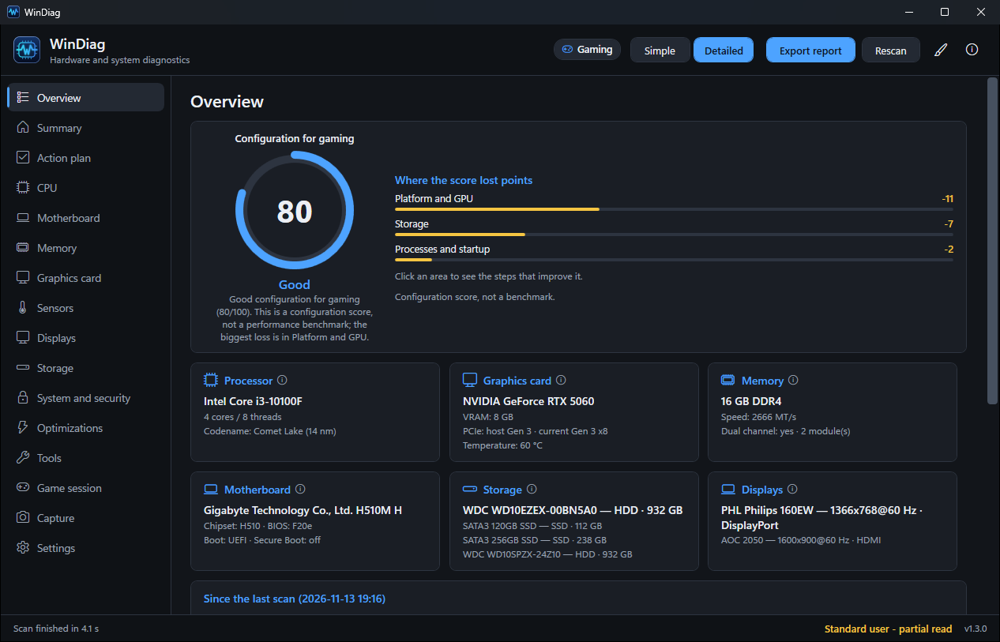
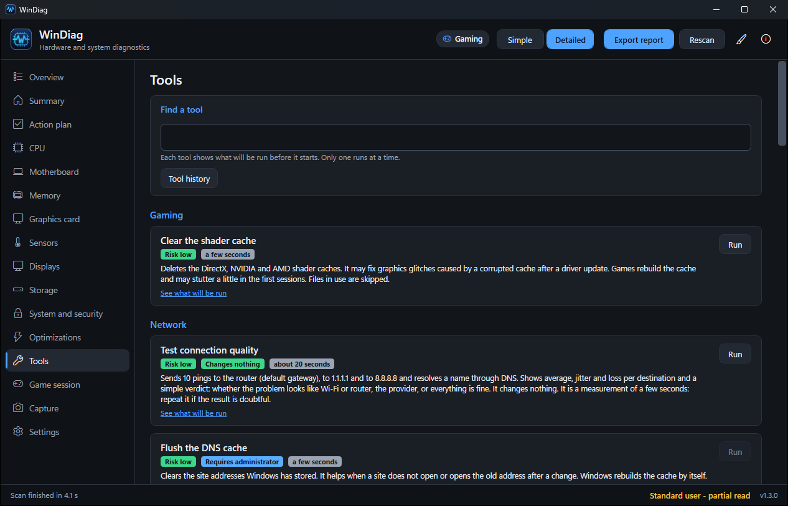
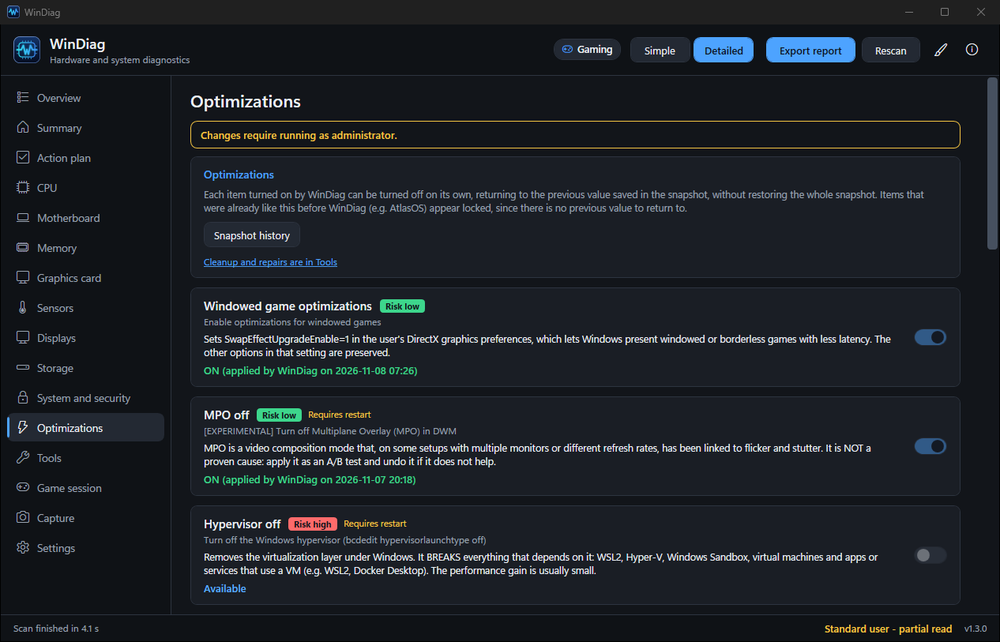
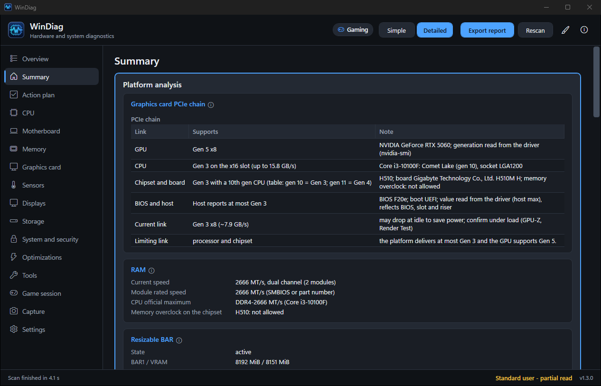
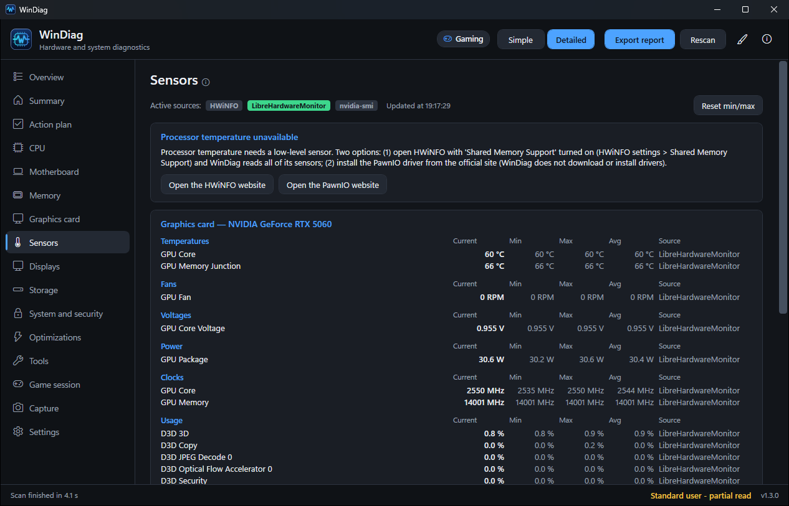
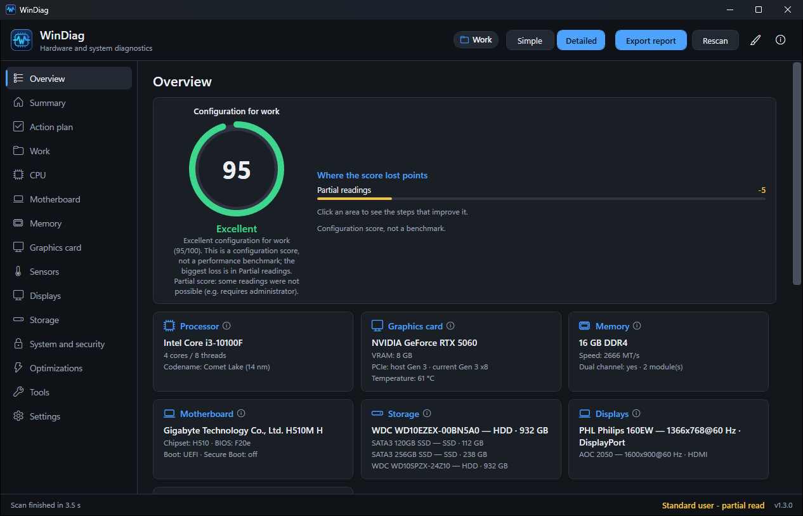
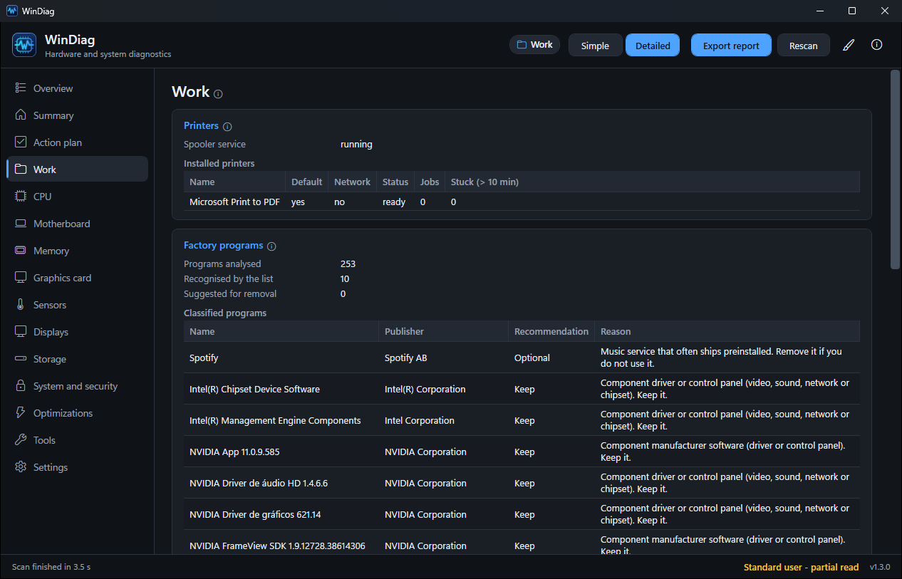
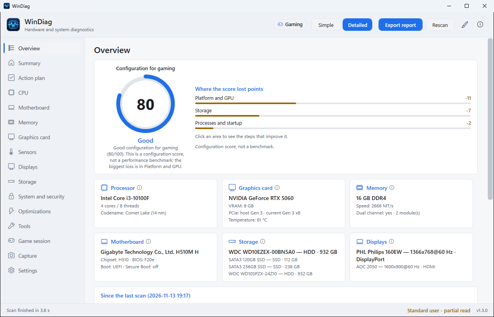

<p align="center">
  
</p>

<h1 align="center">WinDiag</h1>

<p align="center">
  Hardware inventory, explained diagnostics and reversible gaming optimizations for Windows 10/11.
</p>

<p align="center">
  <b>English</b> | <a href="docs/pt-BR/README.pt-BR.md">Português (Brasil)</a>
</p>

<p align="center">
  <a href="https://github.com/dougllascda/WinDiag/releases/latest"></a>
  <a href="https://github.com/dougllascda/WinDiag/releases"></a>
  <a href="https://github.com/dougllascda/WinDiag/actions/workflows/ci.yml"></a>
  <a href="LICENSE"></a>
  
  
</p>

<p align="center">
  
</p>

<table>
  <tr>
    <td align="center"><br><sub>Tools</sub></td>
    <td align="center"><br><sub>Optimizations</sub></td>
  </tr>
  <tr>
    <td align="center"><br><sub>Platform analysis</sub></td>
    <td align="center"><br><sub>Sensors</sub></td>
  </tr>
  <tr>
    <td align="center"><br><sub>Work profile: overview</sub></td>
    <td align="center"><br><sub>Work profile: printers and factory programs</sub></td>
  </tr>
  <tr>
    <td align="center" colspan="2"><br><sub>Overview, light theme</sub></td>
  </tr>
</table>

WinDiag opens already reading everything, with no "detect" button: processor, motherboard, memory, graphics card, monitors, disks (with S.M.A.R.T.), virtualization, antivirus, startup and events. Each finding comes with **what it means** and **what to do**, and the summary ranks the **likely gaming bottlenecks** by impact.

## Highlights

- CPU-Z/GPU-Z-style inventory, read automatically on launch, with live values every second.
- Platform analysis: where the limit is and what can be improved, based on measured readings only.
- Explained diagnostics: every finding says what it means and what to do.
- Reversible optimizations: one switch per item, a snapshot before every change, and undo for that item alone.
- One-click tools: printing, network, cleanup and system repair, with the exact commands shown before you confirm.
- HWiNFO-style sensors tab (current, min, max, average) with temperature, fan, VRM and disk alerts.
- Power supply estimate with a warning if the PSU you declare looks undersized.
- Usage profile **Gaming | Work**: the Work profile covers printers, factory-installed programs (with a recommendation and removal through the official uninstaller), laptop battery and power, Windows Update and boot time; the game tabs are hidden in the Work profile.
- Simple mode (plain language) and Detailed mode; interface and reports in English and Brazilian Portuguese.
- Self-update with SHA-256 verification, on a schedule you choose (including Manually).
- No telemetry, no third-party code downloaded or run, and no runtime-generated code. Internet use is limited to the update check (official repository only) and to the network tools and DISM when you run them.

Documentation site: <https://dougllascda.github.io/WinDiag/>

## Download

Get the latest build from the [Releases page](https://github.com/dougllascda/WinDiag/releases/latest).

| File | Who it is for |
|---|---|
| `WinDiag-Setup-<version>.exe` (**recommended**) | Installer: Start menu entry, optional desktop icon, uninstall from Windows |
| `WinDiag-Portable-<version>.exe` | Portable, nothing to install (runtime embedded) |
| `WinDiag-<version>-fx.exe` | Small download; requires the [.NET 8 Desktop Runtime](https://dotnet.microsoft.com/download/dotnet/8.0) |

## Verify your download

Compare the hash with `SHA256SUMS.txt` from the release:

```powershell
Get-FileHash .\WinDiag-Setup-<version>.exe -Algorithm SHA256
```

Confirm where the build came from with the [GitHub CLI](https://cli.github.com/):

```powershell
gh attestation verify .\WinDiag-Setup-<version>.exe --repo dougllascda/WinDiag
```

More details in [docs/SIGNING.md](docs/SIGNING.md).

## Features

- **Platform analysis:** shows where the limit of the system is and what can be improved, without claiming causes that were not measured.
- **Summary:** OK / INFO / WARNING / ATTENTION counts, likely bottlenecks and every check.
- **CPU, Motherboard, Memory, Graphics, Monitors, Storage, System and security:** inventory with live readings (per-thread clock, load, RAM, temperature, power, GPU clocks and PCIe link).
- **Sensors:** current, min, max and average values. Reads from HWiNFO (with Shared Memory Support enabled) and from the bundled LibreHardwareMonitor library.
- **Optimizations:** one switch per item. Turning it on takes a snapshot first; turning it off restores only that item. Items already set outside WinDiag (for example by AtlasOS) are shown as locked. A snapshot history can restore a whole snapshot.
- **Usage profile (Gaming | Work):** Gaming keeps the game-focused analysis, Game session and Capture. Work shows printers, factory-installed programs (recommendation and removal through each program's official uninstaller), laptop battery and power, Windows Update and boot time, and hides the game tabs.
- **Updates:** Settings > Updates sets how often WinDiag checks (On app start, Daily, Weekly, Monthly, Manually). When a version is newer, a banner offers Update now, What's new, Skip this version and Later. "Update now" asks for confirmation, downloads the file for your install type, verifies its SHA-256, closes the app, installs and reopens it.
- **Tools:** one-click maintenance (see [Tools](#tools)). Each tool shows the exact commands, asks for confirmation and keeps a history.
- **Game session:** lists heavy background apps and closes only the ones you select.
- **Capture:** samples CPU, GPU, DPC, disk, paging and RAM every second while you play, identifies the game process by 3D GPU load and summarizes with percentiles (P50/P95/P99).
- **Settings:** theme (Automatic, Light, Dark), Simple/Detailed mode, language, your power supply, sensor status, data folders and licenses.
- **Export report:** a single HTML (self-contained, light/dark, print-ready) or TXT file, with user name and serial numbers masked.

## Tools

The Tools tab is available in both profiles. Commands are fixed in the code: WinDiag does not write `.bat` files, does not download third-party code and does not generate scripts. Each tool shows exactly what it will run. Tools that change something or need administrator rights ask for confirmation first; read-only ones without administrator (connection test, battery report, memory diagnostic, shortcuts) run directly. Output is shown live, with a Cancel button. WinDiag never restarts the PC.

| Category | Tool | What it does | Admin | Restart |
|---|---|---|---|---|
| Printing | Unstick print queue | Stops the Spooler, deletes pending jobs, starts it again | Yes | No |
| Printing | Restart Spooler / Test page | Restarts the service / prints the Windows test page | Yes / No | No |
| Network | Network test | Pings the gateway of the adapter that reaches the internet, 1.1.1.1 and 8.8.8.8, plus one name lookup; shows latency, jitter, loss and a verdict. Changes nothing | No | No |
| Network | Flush DNS / Renew IP / Sync time | `ipconfig /flushdns`, `ipconfig /renew`, `w32tm /resync` | Yes | No |
| Network | Reset network stack | `netsh winsock reset` and `netsh int ip reset`. The confirmation lists any static IPs that would be erased and requires ticking "I understand" | Yes | Yes |
| Cleanup | Disk cleanup | Temporary files, Windows Update and Delivery Optimization caches, thumbnails, error reports, Recycle Bin. You pick the items and see their sizes | No | No |
| Gaming | Shader cache | Clears the DirectX, NVIDIA and AMD shader caches | No | No |
| Repair | SFC / DISM / CHKDSK | `sfc /scannow`, `DISM /Online /Cleanup-Image /RestoreHealth`, `chkdsk /scan` (read-only) | Yes | No |
| Repair | Reset Windows Update | Stops the services, renames `SoftwareDistribution` and `catroot2`, starts them again | Yes | No |
| Repair | Restart Explorer / Memory diagnostic | Restarts the shell / opens the Windows Memory Diagnostic (Windows asks about the restart) | No | No |
| Repair | Restore point | Creates a restore point | Yes | No |
| Reports | Battery report | `powercfg /batteryreport`, opened in the browser | No | No |
| Shortcuts | Device Manager, printers, apps, Windows Update, Disk Management, Reliability Monitor | Open the matching Windows tool | No | No |

Tools are not reversible, except through a restore point, which WinDiag offers before every tool whose risk is not low (unstick printing, reset network stack, DISM, reset Windows Update). Details: [docs/modules/tools.md](docs/modules/tools.md).

## Safety

**Reads, without changing anything:** WMI/CIM, the registry, performance counters, `nvidia-smi --query`, `powercfg /query`, `bcdedit /enum`, `fltmc filters`, `fsutil behavior query` and event logs.

**Optimizations change something only when you turn a switch on and confirm:**

| Item | Change |
|---|---|
| Game DVR | `GameDVR_Enabled` / `AppCaptureEnabled` = 0 |
| HAGS | `HwSchMode` = 2 |
| Memory compression | `Enable-MMAgent` / `Disable-MMAgent -MemoryCompression` |
| Windowed game optimizations | `SwapEffectUpgradeEnable=1` in `DirectXUserGlobalSettings` (other options preserved) |
| USB selective suspend / ASPM | `powercfg /setacvalueindex` (plugged in) |
| Game Mode | `AutoGameModeEnabled` = 1 |
| Startup apps | `StartupApproved` (same mechanism as Task Manager) |
| SysMain / Windows Search | service startup type |
| Hibernation | `powercfg /hibernate off` |
| Memory Integrity (HVCI) | `HypervisorEnforcedCodeIntegrity\Enabled` = 0 |
| Hypervisor (high risk) | `bcdedit /set hypervisorlaunchtype off` |
| Forced HPET | `bcdedit /deletevalue useplatformclock` |
| MPO (experimental) | `Dwm\OverlayTestMode` = 5 |
| Mouse acceleration | turns off "Enhance pointer precision" (Gaming) |
| Sticky/Filter/Toggle Keys | turns off the keyboard shortcuts that open them (Gaming) |
| Power plan (Gaming, desktop only) | switches to High performance, if that plan exists |
| Default printer lock (Work profile) | stops Windows from changing the default printer |
| Power plan (Work profile) | desktop on Power saver → High performance; laptop on High/Ultimate performance → Balanced (reversible; only if the target plan exists) |
| Uninstall factory-installed programs | opens the program's own official uninstaller; never silent, never automatic (not reversible) |

- High-risk items ask you to type `CONFIRM` before they are applied.
- Optimizations save a JSON snapshot of the previous state in `%ProgramData%\WinDiagMaint\snapshots\` before they are applied; the history is in `changes.log`. Turning the switch off, or restoring a snapshot, goes back to the saved value.
- Tools have no snapshot. They show the commands they will run, ask for confirmation when they change something or need administrator rights, record each run in `changes.log` and `%ProgramData%\WinDiagMaint\tools-history.json`, and offer a restore point before every tool whose risk is not low. Uninstalling factory-installed programs is also not reversible and always asks for confirmation.
- No telemetry. WinDiag does not download or run third-party code. The update check (configurable frequency, weekly by default, can be Manual) queries only the official repository; download and installation happen only on your click, with the file verified by SHA-256. The network tools (connection test: ping to 1.1.1.1 and 8.8.8.8 and one name lookup; clock sync) and DISM use the internet when you run them. Update settings are in Settings > Updates (On app start, Daily, Weekly, Monthly or Manually). The downloaded file is checked against the `SHA256SUMS.txt` of the same release. The executables are not code-signed yet, so this check proves integrity, not authorship (see [docs/modules/updates.md](docs/modules/updates.md)).
- No obfuscation, packer or runtime-generated code. Native calls are limited to documented Win32 APIs.
- Gains vary by PC and game; optimizations are optional. Read more in [SECURITY.md](.github/SECURITY.md).

## FAQ

**Windows SmartScreen warns me about the file.**
The executables are not code-signed yet, so SmartScreen may show a warning. Choose "More info" > "Run anyway" after checking the SHA256 hash and the build attestation (see [Verify your download](#verify-your-download)).

**Why does it ask for administrator rights?**
S.M.A.R.T., BCD, file system minifilters and the optimizations need that access. Without it, the app still opens and marks affected readings as partial ("requires administrator").

**My antivirus flagged it.**
The executable is unsigned and, when you turn optimizations on, changes system settings (registry, BCD, power) and runs maintenance commands. Some antivirus products may be suspicious of that. Please open an issue with the detection name and the version.

**The CPU temperature is missing.**
Windows does not expose the core sensor without a third-party driver. Either open HWiNFO with **Shared Memory Support** enabled, or install the PawnIO driver from its official website so the bundled LibreHardwareMonitor library can read it. WinDiag does not include, download or install that driver.

**The power supply is not detected.**
Software cannot detect a PSU on most systems. Enter it in **Settings** and the app will compare it with the estimated peak consumption. Digital Corsair/NZXT units can be detected over USB.

**Which languages are supported?**
English and Brazilian Portuguese. The automatic option follows Windows and can be changed in Settings; numbers and dates follow the language.

WinDiag does not measure frame time or point to the driver responsible for DPC latency; use PresentMon/CapFrameX and LatencyMon for that.

## Build from source

Requires the [.NET 8 SDK](https://dotnet.microsoft.com/download/dotnet/8.0).

Building from source is allowed only to evaluate the software and to prepare contributions (see [LICENSE](LICENSE)); the binaries you build must not be distributed.

```powershell
dotnet build app\WinDiag.sln -c Debug
dotnet test app\WinDiag.sln
pwsh -File tools\publish.ps1 -Scan   # builds dist\ and, if Kaspersky is installed, scans it
```

- `app\WinDiag.Core`: collectors, rules, the optimization engine and the report.
- `app\WinDiag.App`: WPF interface.
- `app\WinDiag.Cli`: headless test tool (`--dump`, `--live`, `--fixes`, `--dry-enable`, `--dry-disable`, `--tools`, `--dry-tool`).
- `app\WinDiag.Tests`: xUnit tests.
- `docs\ARCHITECTURE.md`: architecture overview.

## Contributing

Issues and suggestions are welcome, in English or Portuguese. Pull requests are accepted only under the Contributor License Agreement (CLA) described in [.github/CONTRIBUTING.md](.github/CONTRIBUTING.md). To report a vulnerability, see [.github/SECURITY.md](.github/SECURITY.md).

## License

Source-available, not open source: you may use the official releases for free on computers you own or are authorized to administer, including when giving technical support to others, as long as you do not redistribute, resell or charge for the software itself; copying, modifying, redistributing or selling the code or binaries is not allowed without written permission. © 2026 dougllascda. See [LICENSE](LICENSE). Third-party components and their licenses: [THIRD-PARTY-NOTICES.md](THIRD-PARTY-NOTICES.md).
