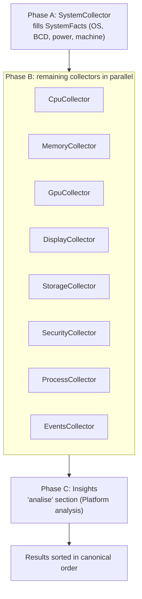

# WinDiag architecture

This document describes how WinDiag is organized. It follows the code: when they disagree, the code wins.

## Overview

The solution `app\WinDiag.sln` has four projects, all on .NET 8 (`net8.0-windows`):

| Project | Role |
|---|---|
| `WinDiag.Core` | Collectors, analysis rules, live sampling, the optimization engine (FixEngine), the tools runner (ToolRunner) and the report. No UI. |
| `WinDiag.App` | WPF interface (tabs, themes, dialogs). Produces `WinDiag.exe`. |
| `WinDiag.Cli` | Headless test tool (`--dump`, `--live`, `--fixes`, `--dry-enable`, `--dry-disable`, `--tools`, `--dry-tool`, `--check-update`, `--download-update`). |
| `WinDiag.Tests` | xUnit tests. They see the `internal` types of Core through `InternalsVisibleTo`. |

Common configuration (version, nullability, XML documentation) lives in `app\Directory.Build.props`. The version has a single source, the `Version` property; the `AppInfo` class (Core) reads it from the assembly and exposes `AppInfo.Version` and `AppInfo.Title`.

Principles that guide the code:

- **Collectors are read-only** and never crash the app. Every read that can fail is in a `try/catch`; the failure becomes a note (for example "requires administrator") and the field shows `n/d`.
- **Every adjustment goes through FixEngine**, with a snapshot written first and an undo available. **Every one-click tool goes through ToolRunner**, with fixed commands, a confirmation that shows them, and a record in `changes.log` and `tools-history.json`.
- **No cause is claimed without a measurement.** Findings carry the evidence that was read; the text separates what was measured from what is likely.
- External processes (`nvidia-smi`, `powercfg`, `bcdedit`, `fltmc`) run through `Util.Proc`, with a timeout and no window.

## Module documents

Each area has its own technical document, including a "How to extend" section:

| Document | Covers |
|---|---|
| [Scan engine](modules/scan-engine.md) | Phases A/B/C, `SectionReady`, `SectionCount`, `ProfileOverride` |
| [Collectors](modules/collectors.md) | `ICollector` contract, each collector and its sources |
| [Analysis and rules](modules/analysis-and-rules.md) | `Insights`, `PlatformDb`, `GameScore`, `ActionPlan`, `Bottlenecks`, `Scope` |
| [Optimizations](modules/optimizations.md) | `FixCatalog`, `FixEngine`, states, snapshots, undo |
| [Tools](modules/tools.md) | `ToolCatalog`, `ToolRunner`, `DryRun`, `BlockReason`, history |
| [Updates](modules/updates.md) | `UpdateCheck`, `UpdateInstaller`, frequency, SHA-256, trust model |
| [Sensors](modules/sensors.md) | HWiNFO, LibreHardwareMonitor, PawnIO, `SensorHub`, alerts |
| [Work profile](modules/work-profile.md) | `WorkCollector`, `BloatwareDb`, `Uninstaller`, battery, printers |
| [History and report](modules/history-and-report.md) | `ScanHistory`, `ReportWriter`, masks |
| [User interface](modules/ui.md) | `MainWindow`, tabs, `ThemeManager`, modes, profiles, `Prefs` |
| [Localization](modules/localization.md) | `Loc.T`, `Fmt`, English tests |

The generated API reference (DocFX) is built from the XML comments in the code; see `docs\api`.

## Scan phases

`ScanEngine.RunAsync` runs the scan in phases:



- **Phase A.** `SystemCollector` runs alone because it fills facts the others use (Windows build, `bcdedit` output, power plan, whether it is a laptop, AtlasOS).
- **Phase B.** The remaining collectors run in parallel (`Task.Run`). Each `SectionResult` is published as soon as it is ready through the `SectionReady` event, and the UI fills the matching tab without waiting for the whole set.
- **Phase C.** The "Platform analysis" section (key `analise`) is computed from all facts and findings after phase B finishes. It says where the platform limit is and what can be improved. The implementation is in `Rules\` and depends only on readings already taken.
- At the end, `Results` is sorted in canonical order (the same as `CreateCollectors`). Access to the list uses `lock (Results)`.
- If a collector throws, `ScanEngine` creates a `SectionResult` with `Error` and a note; the scan continues.

## Contracts

### ICollector

```csharp
public interface ICollector
{
    string Key { get; }      // stable, e.g. "cpu"; selects the tab
    string Title { get; }
    SectionResult Collect(SystemFacts facts);
}
```

A collector reads one area of the system and returns data and checks. It changes nothing and must not throw.

### SectionResult

Output of a collector:

- `Groups`: list of `InfoGroup` (title, "label: value" rows as `InfoRow`, `InfoTable` and notes). `Add` turns a null or empty value into `n/d`.
- `Findings`: list of `Finding`.
- `Notes`: reads that failed or were partial (they feed "Partial readings" in the report).
- `Elapsed` and `Error` (a fatal collector error, which should not happen).

### Finding

Immutable record: `Sev` (`Ok < Info < Aviso < Atencao`), `Title`, `Evidence`, and optionally `Explain` ("what it means"), `Action` ("what to do"), `FixId` (links to an item in the optimization catalog), `ToolId` (links to the tool that resolves it) and `Impact` (0 to 100, ranks the likely gaming bottlenecks). `Section` is filled in by `ScanEngine`.

### SystemFacts

Facts shared among collectors, rules and the catalog (for example `IsAdmin`, `OsBuild`, `Bcd`, `HAGS`, `GameDVR`, `Displays`, `StartupItems`). Each collector fills only the properties of its area. Because phase A runs first, `Os`, `Bcd` and power are already available to the others.

## Localization

User-facing text is bilingual (Brazilian Portuguese and English) through `Loc.T(pt, en)`. `Loc.Set` selects the language (Automatic follows Windows) and numbers and dates follow it. Checks have stable identifiers that do not depend on the language, so history and the action plan keep working when the language changes.

## Live sampling (LiveSampler)

`LiveSampler.Sample()` returns one `LiveSample` per call; the UI calls it every second. `CpuLive` reads per-thread clock, load, DPC, RAM and page faults; `GpuLive` reads temperature, clocks, power, utilization, VRAM, fan, P-state, throttle reason and PCIe (NVIDIA through `nvidia-smi`, others through counters). Each reader is protected by `try/catch`; a field with no reading is `null` and the UI shows `n/d`. `Capture` and `GameSession` use the same samples for the Capture tab (P50/P95/P99 percentiles, game process detection by 3D load) and for the Game session.

## Sensors

The Sensors tab merges two sources: HWiNFO, read from its shared memory when "Shared Memory Support" is enabled, and the bundled LibreHardwareMonitor library. The library reaches CPU, motherboard and memory sensors through the PawnIO driver, which WinDiag does not include, download or install; it is used only if the user installed it from the official website. Without a source, the field shows `n/d` and a note explains why. The sensor values feed temperature, fan, VRM and disk alerts and the thermal throttling flag in the capture.

## FixEngine and SnapshotStore

`FixCatalog` defines the items (`FixDefinition`): registry, services, BCD, power plan, memory compression, hibernation, mouse and keyboard accessibility options, default printer and startup apps, with `Applicable` (it makes sense to apply) and `IsActive` (already in effect).

### States

`FixEngine.GetStatuses(facts)` returns one `FixStatus` per item, with one of these states (`FixStatusKind`):

| State | Meaning |
|---|---|
| `Disponivel` | It makes sense to apply and it is not in effect yet. |
| `AtivoWinDiag` | In effect and applied by WinDiag (the item's latest snapshot is a reversible "Apply"). It can be undone on its own. |
| `AtivoExterno` | In effect, but not by WinDiag (AtlasOS, a manual tweak or the Windows default). Locked: there is no safe previous value. |
| `NaoAplicavel` | Does not apply to this PC. |

### Operations

- `Enable(fix, facts)`: captures the current state, writes the snapshot with `Action = "Aplicar"` and only then applies.
- `Disable(status)`: restores **only that item** from the saved state and writes a snapshot with `Action = "Desfazer"`, so the history stays consistent.
- `DryRun = true`: nothing is changed or written; it only returns messages describing what would be done (used by the CLI).
- The result (`OpResult`) carries messages, a restart flag and the snapshot path.

### Snapshots

Files `snapshot_yyyyMMdd_HHmmss.json` in `%ProgramData%\WinDiagMaint\snapshots\`, plus the text history `changes.log` in `%ProgramData%\WinDiagMaint\`. The `Action` field is optional; snapshots without it count as "Aplicar". The values `Aplicar` and `Desfazer` are stored as-is and are not translated.

```json
{
  "Created": "2026-11-08T09:00:00",
  "Version": "1.1.1",
  "Fixes": [
    {
      "Id": "GAMEDVR",
      "Name": "Desativar captura em segundo plano do Xbox Game DVR",
      "Reversible": true,
      "Action": "Aplicar",
      "State": { "Reg": [], "Svc": [], "Mmc": null, "Bcd": [], "Hib": null, "Power": [] }
    }
  ]
}
```

`State` stores the "before" value of each target (registry, service, BCD, power, MMAgent, hibernation). `SnapshotStore.List()` ignores unreadable files; `LatestEntry` finds the most recent entry (Apply or Undo) for an item, which decides whether the active state was turned on by WinDiag. The history window can also restore a whole snapshot.

## Tools

`ToolCatalog` holds the one-click actions (printing, network, cleanup, system repair, battery, shortcuts). They are not switches and have no snapshot. `ToolRunner` shows nothing by itself: `BlockReason` is checked first, the UI asks for confirmation with the exact commands (read-only tools without administrator run directly), `RunAsync` streams the output through `Proc.RunStreaming` and the run is recorded in `changes.log` and `%ProgramData%\WinDiagMaint\tools-history.json`. The app never restarts the PC. Details: [Tools](modules/tools.md).

## Report

`ReportWriter` exports one file at a time:

- `WriteHtml(engine, path)`: self-contained HTML (embedded CSS, no JavaScript, no external resources), tabs through `input radio`, automatic light/dark theme (`prefers-color-scheme`) and print CSS that shows all panels.
- `WriteTxt(engine, path)`: UTF-8 text with BOM, 78 columns wide.
- `DefaultFileName("html")` produces a name like `WinDiag_Report_yyyyMMdd_HHmm.html` (or `WinDiag_Relatorio_...` in Portuguese).
- The "Platform analysis" section, if present, comes before the Summary.
- `ReportMask` masks **only in the exported file**: the user name becomes `<USER>` and serial numbers show only the last 4 characters. The UI masks nothing.

## Interface (WPF)

- A single window with tabs: Summary, Platform analysis, Sensors, one tab per collector (CPU, Motherboard, Memory, Graphics, Monitors, Storage, System and security), Optimizations, Tools, Game session, Capture and Settings.
- Inventory tabs are filled by the `SectionReady` event as collectors finish; live values come from `LiveSampler`.
- `ThemeManager` switches between Automatic (follows Windows), Light and Dark by updating the brushes of a shared palette in place (`Themes\ThemeManager.cs`; styles in `Themes\Styles.xaml`).
- The Optimizations tab shows one card per item with a switch, according to the `FixStatus`.
- Every action that changes the system asks for confirmation and uses `FixEngine` (adjustments) or `ToolRunner` (tools).

## Test CLI

`WinDiag.Cli` runs the scan and the engine without a UI, which is useful for debugging and local CI. See [CONTRIBUTING.md](https://github.com/dougllascda/WinDiag/blob/main/.github/CONTRIBUTING.md) for the commands. The CLI and `--dry-*` never change the system (`FixEngine` is created with `dryRun: true`).

## Decisions

- **No telemetry.** WinDiag does not download or run third-party code. The update check (configurable frequency, weekly by default, can be Manual) queries only the official repository; download and installation happen only on your click, with the file verified by SHA-256. The network tools (connection test: ping to 1.1.1.1 and 8.8.8.8 and one name lookup; clock sync) and DISM use the internet when you run them. See [Updates](modules/updates.md).
- **No third-party code.** Nothing from third parties is downloaded or run at runtime; there is no obfuscation, packer, `Reflection.Emit` or runtime-generated code. Only documented Win32 P/Invoke.
- **UAC in Release.** The `app.manifest` manifest requests `requireAdministrator`, because S.M.A.R.T., BCD, minifilters and the optimizations need that access.
- **`asInvoker` in Debug.** The `app.debug.manifest` manifest runs without elevation to make testing easier; the app reports what was partial ("requires administrator").
- **Reversibility.** Adjustments are reversible. Tools are not (except through a restore point) and say so before they run.
- **Compatibility.** The snapshot format follows the earlier internal versions, and older snapshots appear in the app.


