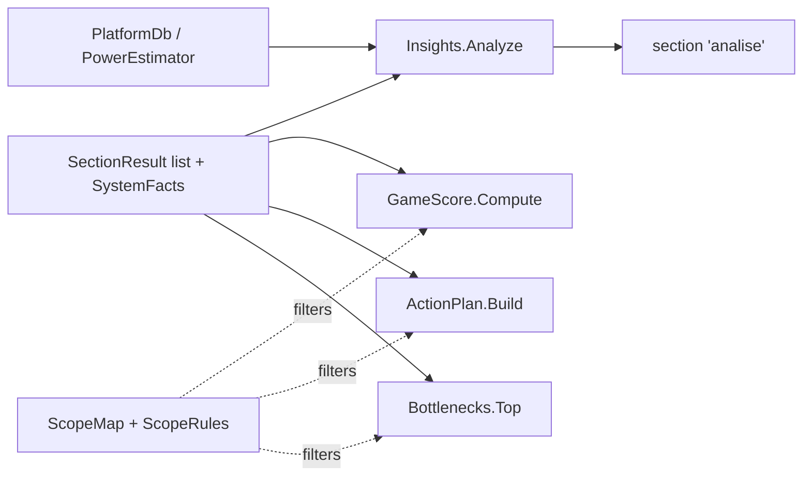

# Analysis and rules

Everything here is in `WinDiag.Core\Rules`, `Knowledge` and `Model`. Rules are pure functions of the readings already taken: they never query the system.

## Findings and severity

`Finding` is an immutable record: `Sev` (`Severity`: `Ok < Info < Aviso < Atencao`), `Title`, `Evidence`, `Explain`, `Action`, `FixId`, `Impact` (0 to 100). Properties set by `SectionResult.Find` and `ScanEngine`: `Section`, `Id` (stable, language-independent), `Simple` (plain-language text for Simple mode), `GuideTopic` (BIOS guide) and `Scope`. Evidence states what was measured; the text must not claim a cause that was not measured.

## Insights (phase C)

`Insights.Analyze(SystemFacts f, IReadOnlyList<SectionResult> results)` builds the section `Insights.SectionKey` = `"analise"` ("Platform analysis"). Internally it resolves the CPU, chipset and GPU with `PlatformDb` and runs topic routines: the PCIe chain (`PcieChain`), memory (speed, channels, XMP/EXPO), Resizable BAR (`ReBar`), CPU/GPU balance (`Balance`), PSU headroom (`Psu`, with `PowerEstimator.Estimate`) and `Upgrade`. Each routine states "where the limit is", "what can be improved", cost and expected gain, with ids such as `analise.rebar_off`, `analise.balance_cpu`, `analise.psu`, `analise.upgrade`.

## PlatformDb

Static knowledge in `Knowledge\PlatformDb.cs`:

| Type | Content |
|---|---|
| `CpuSpec` | Vendor, family, generation, socket, CPU PCIe generation, official DDR4/DDR5 limits (`MaxRamMTs`), cores, TDP. `PlatformDb.ResolveCpu(name)` |
| `ChipsetSpec` | Name, vendor, socket, x16 PCIe generation per CPU generation (`X16Gen`), memory overclock support. `ResolveChipset(text)` |
| `GpuSpec` | Family, PCIe generation, lanes, tier, Resizable BAR support. `ResolveGpu(name, isLaptop)` |
| `UpgradeSuggestion` | `UpgradePath(cpu, chipset, cores, threads, pcieGen)` |

An unknown model resolves to `null`, and the rule then says the data is not available instead of guessing. `BiosGuides.For(topic, boardManufacturer)` supplies step-by-step guides referenced by `GuideTopic`; `Glossary.Lookup` supplies explanations for the info icons (`Glossary.En.cs` holds the English text).

## Scope and ScopeMap

`UsageProfile` (`Gaming`, `Work`) is the user's choice. `Scope` (`Both`, `Gaming`, `Work`) labels a finding or fix. `ScopeRules.Matches(scope, profile)` is true for `Both` or an equal profile. `ScopeMap.For(id)` classifies findings by id prefix as `Gaming` (for example `pcie.`, `analise.balance`, `gpu.hags`, `gpu.gamedvr`, `seguranca.hypervisor`, `processos.background_apps`); everything else is `Both`. `SectionResult.Find` consults it when the collector gives no scope, so the classification lives in one place. Work findings are created with an explicit `Scope.Work`.

## GameScore

`GameScore.Compute(findings, profile)` returns a `ScoreResult(Score, Grade, Summary, Parts)`. It is a configuration score, not a benchmark.

- Only findings matching the profile count. Duplicates (same section and title, or same section and action) count once.
- Weight per finding: `Atencao` 0.20, `Aviso` 0.12, `Info` with `Impact >= 30` 0.04. Loss = `Impact * weight`.
- Losses are grouped by area (`AreaOf`) and each area is capped at 35 points. Score = `100 - sum(area losses)`, clamped to 0..100.
- Grades: 90+ Excellent, 75+ Good, 55+ Fair, below Limited.
- Gaming areas follow the section key (for example `Plataforma e GPU`, `Processador e memória`, `Armazenamento`, `Sistema e segurança`, `Processos e inicialização`). Work areas are `Desempenho e inicialização`, `Armazenamento e memória`, `Impressão`, `Atualizações e segurança` and `Bateria e energia`; `trabalho.*` findings are split by id prefix (`AreaOf(Finding, profile)`).

## ActionPlan

`ActionPlan.Build(findings, profile)` returns an ordered `List<ActionStep>` (`Key`, `Order`, `Title`, `Where`, `What`, `Cost`, `Gain`, `Sev`, `Impact`, `FixId`, `SectionKey`...). `ActionCost` separates free configuration steps from hardware. The plan puts free steps first, then orders by severity and impact. It parses the "where / what / cost / gain" markers of `Action` text in both languages. Done steps are stored by the UI in `PlanStore` (`UserPrefs.PlanDone`).

## Bottlenecks

`Bottlenecks.Top(findings, profile, max = 5)` keeps findings with `Sev >= Aviso`, `Impact > 0` and a matching scope, ordered by `Impact` then severity. `Bottlenecks.Count` tallies findings by severity.

## How to extend

- **New finding.** Call `res.Find(...)` in a collector or in an `Insights` routine with a new stable `id`. If it only matters while gaming, add its prefix to `ScopeMap` (or pass `scope:`).
- **New platform.** Add a row to the relevant list in `PlatformDb`. Keep names matching what Windows reports.
- **New score area.** Update `AreaOfCore` or the work area mapping in `GameScore`, plus the tests in `ScoreHistoryTests`/`InsightsTests`.
- **BIOS guide.** Add a `BiosTopic` value and its text in `BiosGuides`, then pass `guide:` in the finding.

