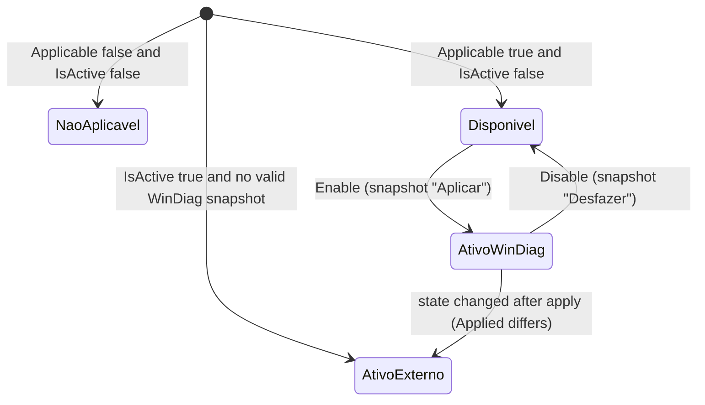

# Optimizations

Every change WinDiag makes to the system is an item of `FixCatalog`, executed by `FixEngine`, written to a snapshot first and undoable per item (except one-off actions and temp cleanup, which say so in the UI). Code is in `WinDiag.Core\Fixes`.

## Catalog

`FixCatalog.All` is a static list of `FixDefinition`. `FixCatalog.Get(id)` looks one up case-insensitively.

A `FixDefinition` declares what to change; it holds no logic for applying it:

| Group | Properties |
|---|---|
| Identity | `Id` (stable, e.g. `GAMEDVR`), `NameText`, `ShortNameText`, `ExplainText` (pt, en tuples; `Name`, `ShortName`, `Explain` resolve through `Loc.T`) |
| Risk | `Risk` (`FixRisk`: `Baixo`, `Medio`, `Alto`), `Reboot`, `Reversible`, `Scope` |
| Predicates | `Applicable(facts)` (makes sense and is not in effect), `IsActive(facts)` (in effect) |
| Targets | `Reg` (`RegSet`), `Svc` (service names), `Bcd` (`BcdSet`), `Power` (`PowerSet`) |
| Special actions | `DxString`, `Mmc`/`MmcOn`, `Hib`, `Temp`, `StartupApps`, `PowerPlan` |
| One-off actions | `IsAction` with `SpoolerRestart` or `PrintQueueClear` (not switches, no undo) |

Items: `TEMP`, `GAMEDVR`, `HAGS`, `MMC`, `MMC_ON`, `WINDOWED_OPT`, `USB_SUSPEND_OFF`, `ASPM_OFF`, `GAMEMODE_ON`, `STARTUP_APPS`, `SYSMAIN`, `WSEARCH`, `HIBER`, `HVCI_OFF`, `HYPERVISOR_OFF`, `HPET_OFF`, `MPO_OFF`, `POWER_PLAN_WORK`, `SPOOLER_RESTART`, `PRINT_QUEUE_CLEAR`. Gaming-only items carry `Scope.Gaming`; the work items carry `Scope.Work`. `GetStatuses` returns every item; the UI filters by profile with `ScopeRules.Matches`.

## States

`FixEngine.GetStatuses(facts)` returns one `FixStatus` per item (`Fix`, `Kind`, `Source`, `SourceFile`, `RebootPending`, `IsOn`, `CanToggle`, `StatusText`).



`FixStatusKind`:

| Kind | Meaning |
|---|---|
| `Disponivel` | It makes sense to apply and it is not in effect. |
| `AtivoWinDiag` | In effect and the latest snapshot entry for the item is a reversible `Aplicar` whose recorded `Applied` state still matches the system. It can be undone alone. |
| `AtivoExterno` | In effect, but not by WinDiag (AtlasOS, manual tweak, Windows default, or changed after WinDiag applied it). Locked: there is no safe previous value. |
| `NaoAplicavel` | Does not apply to this PC. |

`POWER_PLAN_WORK` is applicable on a desktop PC whose active plan is Power saver (switches to High performance) and on a laptop running High or Ultimate performance (switches to Balanced), only when the target GUID appears in `powercfg /list` (`SystemFacts.PowerPlanGuids`); custom plans are left alone. It is reversible (snapshot with `PowerPlan`). Uninstalling factory-installed programs is not part of the catalog: `Uninstaller` only opens the program's own interactive uninstaller (no silent mode, refuses `HKCU` and script commands), with confirmation and without snapshot.

Items with `Temp`, `StartupApps` or `IsAction` are never active: they are `Disponivel` or `NaoAplicavel`. `HVCI_OFF` reports `RebootPending` while `facts.HvciRunning` is true.

## Operations

| Method | Behavior |
|---|---|
| `Enable(fix, facts)` | `Capture` the current state, save the snapshot (`Action = "Aplicar"`), apply, then capture `Applied` and rewrite the snapshot. |
| `Disable(status)` | Restore only that item from the saved `State` and save a snapshot with `Action = "Desfazer"`. |
| `RunAction(fix)` | One-off actions (Spooler restart, print queue clear). No snapshot, no undo, always confirmed. The Spooler is started again even if the action fails midway, and the action is `NaoAplicavel` when the service is disabled (`SystemFacts.SpoolerDisabled`). |
| `CleanTemp()` | Clears temporary files. Not reversible. |
| `SetStartupApp(item, enable)` | Enables or disables one startup item (StartupApproved bytes), with snapshot. |
| `RestoreSnapshot(file)` | Restores every item of a whole snapshot (history window). |
| `Capture`, `CaptureLike`, `Restore` | Read the "before" state and write it back. |

`FixEngine(store, dryRun)`: with `DryRun = true` nothing is changed or written; the result only lists what would be done (CLI `--dry-enable`, `--dry-disable`). Every operation returns an `OpResult` (`Ok`, `Messages`, `RebootNeeded`, `SnapshotPath`, `Error`).

## Snapshots

`SnapshotStore` (default root `%ProgramData%\WinDiagMaint`) writes `snapshots\snapshot_yyyyMMdd_HHmmss.json` (a numeric suffix `_n` avoids collisions) in UTF-8 without BOM and appends a text history in `changes.log`. `List()` ignores unreadable files. `LatestEntry(snaps, id)` returns the newest entry of an item (apply or undo); it decides `AtivoWinDiag`. `Rewrite(path, snap)` only accepts files inside `snapshots`.

```json
{
  "Created": "2026-11-08T09:00:00",
  "Version": "1.1.1",
  "Fixes": [
    {
      "Id": "GAMEDVR",
      "Name": "Desativar captura em segundo plano do Xbox Game DVR",
      "Reversible": true,
      "Action": "Aplicar",
      "State":   { "Reg": [], "Svc": [], "Mmc": null, "Bcd": [], "Hib": null, "Power": [], "PowerPlan": null },
      "Applied": { "Reg": [], "Svc": [], "Mmc": null, "Bcd": [], "Hib": null, "Power": [] }
    }
  ]
}
```

- `Action` is `Aplicar` or `Desfazer` (`SnapshotActions`), stored as-is and never translated. A missing value counts as `Aplicar` (`SnapshotFix.IsApply`).
- `State` (`FixState`) is the value before the change: `Reg` (`RegState`), `Svc` (`SvcState`: running, `Start`, `Delayed`), `Bcd` (`BcdState`), `Power` (`PowerState`: subgroup, setting, old AC value, optional scheme GUID), `Mmc`, `Hib`, `PowerPlan` (previous active plan GUID).
- `Applied` is the state right after applying. If the same keys differ later (`FixEngine.StateDiffers`), the item becomes `AtivoExterno`. Snapshots without `Applied` keep the older behavior.

## Safety rules

- The snapshot is written before the change. If it cannot be written, nothing is applied.
- Every method that can fail reports through `OpResult` and does not throw to the UI.
- The UI asks for confirmation before calling the engine (`ConfirmDialog`).
- External commands (`bcdedit`, `powercfg`, `sc`) go through `Util.Proc` with a timeout and no window.

## How to extend

1. Add a `FixDefinition` to `FixCatalog.All` with a new stable `Id`, bilingual texts, `Applicable`, `IsActive` and targets in `Reg`, `Svc`, `Bcd` or `Power`. That is enough for undo: the engine captures and restores those targets.
2. A change that does not fit those four needs a new special flag on `FixDefinition` plus matching branches in `FixEngine.Capture`, `Enable` and `Restore`, and a field in `FixState`. Keep the new JSON fields optional so old snapshots load.
3. Link a finding to it with `fixId:` in `res.Find`.
4. Add tests in `FixTests`/`ReviewFixTests` using a `SnapshotStore` pointed at a temp directory and `dryRun: true`.
