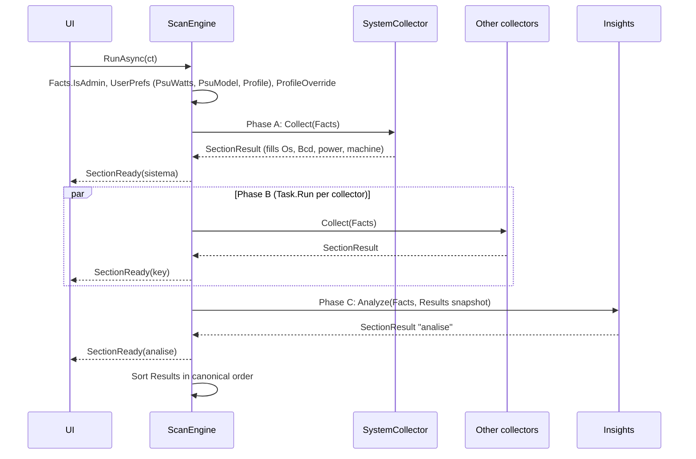

# Scan engine

`ScanEngine` (`WinDiag.Core`) runs a scan: it executes every `ICollector`, publishes each `SectionResult` as soon as it is ready and finishes with the platform analysis. It does not touch the UI and changes nothing on the system.

## Public surface

| Member | Purpose |
|---|---|
| `Facts` (`SystemFacts`) | Facts shared by collectors, rules and the optimization catalog. |
| `Results` (`List<SectionResult>`) | Published sections. Sorted in canonical order when `RunAsync` ends. Access during the scan must use `lock (Results)`, `AllFindings()` or the event. |
| `SectionReady` (`event Action<SectionResult>`) | Raised for each finished section, possibly on a background thread. The UI marshals to the dispatcher. |
| `CreateCollectors()` | Canonical, ordered list of collectors. The first one is phase A. |
| `SectionCount` | `CreateCollectors().Count + 1` (the collectors plus the `analise` section). Used by the progress bar. |
| `ProfileOverride` (`UsageProfile?`) | If set before `RunAsync`, replaces the profile read from the preferences in `Facts.Profile`. Nothing is written. Used by the CLI `--profile`. |
| `IsAdmin()` | Whether the process is elevated; any failure returns `false`. |
| `RunAsync(CancellationToken)` | Runs the whole scan. Only cancellation propagates an exception. |
| `AllFindings()` | Thread-safe copy of the findings published so far. |

## Phases

- **Phase A.** `SystemCollector` runs alone, because it fills facts the others read (Windows build, BCD output, power plan, laptop flag, AtlasOS).
- **Phase B.** All remaining collectors start with `Task.Run`; `Task.WhenAny` publishes each one as it finishes, in completion order.
- **Phase C.** `RunInsights` calls `Insights.Analyze(Facts, snapshot)` after every collector is done. The section key is `Insights.SectionKey` (`"analise"`).
- **Preferences.** Before phase A the engine reads `UserPrefs.Load()` read-only. If `IsFallback` is true (unreadable file) it does not use the values. `Facts.Profile` comes from `UserPrefs.ProfileOf(prefs.Profile)` unless `ProfileOverride` is set.

## Failure isolation

`RunOne` wraps `Collect` in `try/catch`. An exception becomes a `SectionResult` with `Error` set and a localized note; the other collectors continue. `RunInsights` does the same for phase C. After either, `EnsureIds` fills `Finding.Section` and a default `Id` (`SectionResult.DefaultId(section, title)`) for findings built without `SectionResult.Find`. `Elapsed` is measured per section.

## Canonical order

`Results` is sorted by the index in `CreateCollectors()`, with `analise` last. Reports, history and the UI rely on this order.

## How to extend

1. Add a collector (see [collectors](collectors.md)) and register it in `ScanEngine.CreateCollectors()`. `SectionCount` follows automatically.
2. If it needs a fact from another collector, put it in `SystemFacts` and make sure the producer runs in phase A, or read it only from `Results` in phase C.
3. Add a tab in `MainWindow.BuildPages` with the section key (see [ui](ui.md)) and update the English tests if the section has user-visible text (see [localization](localization.md)).
