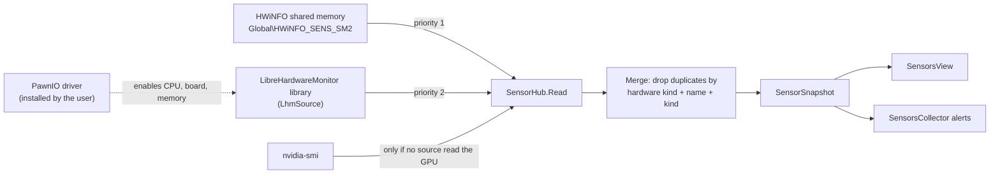

# Sensors

Sensors are read by `SensorHub` (`WinDiag.Core\Sensors`), shown in the Sensors tab (`SensorsView`) and used by `SensorsCollector` for alerts. Everything is read-only. WinDiag does not download, bundle or install any kernel driver.

## Types

| Type | Role |
|---|---|
| `SensorReading` | `Hardware`, `HardwareKind` (stable Portuguese value: `CPU`, `Placa-mãe`, `Placa de vídeo`, `Memória`, `Armazenamento`, `Fonte`, `Controlador`, `Outro`), `Name`, `Kind` (`SensorKind`), `Value`, `Unit`, `Source`. |
| `SensorSnapshot` | `Time`, `Readings`, `SourcesUsed`. |
| `SensorStatus` | `HwInfoAvailable`, `LhmAvailable`, `KernelDriverAvailable`, `DriverName`, `LhmVersion`, `Notes`. |
| `HardwareKinds.HardwareKindLabel` | Localized label for `HardwareKind`; internal values stay in Portuguese. |
| `HardwareClassifier` (internal) | Maps sensor and hardware names to the piece categories. |

## Sources

- **HWiNFO.** `HwInfoSource.Read()` opens the memory-mapped file `Global\HWiNFO_SENS_SM2` (fallback `HWiNFO_SENS_SM2`) read-only, which exists only when "Shared Memory Support" is enabled in HWiNFO. `HwInfoSource.Parse` returns `HwInfoParseResult` with a `HwInfoParseState`: valid, closing (signature `DEAD`), invalid, or stale. `HwInfoFreshness` marks the source stale when the header `poll_time` has not changed for 5 seconds, so a frozen HWiNFO is not shown as live.
- **LibreHardwareMonitor.** `LhmSource.Open(kernelDriver)` opens the bundled library. GPU, storage, PSU and controllers are always enabled; CPU, motherboard and memory are enabled only if the PawnIO service exists (`SensorHub.IsPawnIoInstalled()`, checks the registry). The user must have installed PawnIO from its official site. Failures become `Notes` and `Available = false`.
- **nvidia-smi.** Used only when neither source read the GPU (`SensorHub.NvidiaSource`).

## SensorHub

- The constructor opens the sources and can take seconds: create it off the UI thread. `MainWindow` creates it lazily in `GetHubAsync` and disposes it (`DisposeHub`) on exit.
- `Read()` is not thread-safe and never throws. `Status` is recalculated about every 10 seconds inside `Read`, because HWiNFO can be opened and closed at any time.
- `Merge(sourcesInPriority)` keeps one reading per (hardware kind, normalized sensor name, sensor kind), from the highest-priority source.
- `SensorsCollector.SharedHubLock` is the lock object the scan and the UI share, so they never call `Read` on the same hub at once.

## Alerts (SensorsCollector)

Single-reading thresholds; they do not claim throttling or a cause. Finding ids start with `sensors.`.

| Id | Condition |
|---|---|
| `sensors.cpu_hot` / `cpu_warm` | CPU reading (Package/Tctl/Tdie preferred, else the highest non-threshold reading) at or above 90 / 80 C |
| `sensors.gpu_hot` / `gpu_warm` | GPU core at or above 85 / 80 C |
| `sensors.gpu_hotspot` | Hot spot at or above 95 / 90 C |
| `sensors.fan_stopped_<piece>` | Fan at 0 RPM while the piece is at or above 70 C (`FanTempCut`) and no other fan of the piece is spinning |
| `sensors.disk_hot.<disk>` | Disk temperature above the limit for its type (NVMe, SSD or HDD), matched to the physical disk by normalized name |
| `sensors.vrm_hot` | VRM/MOSFET reading above 100 C |
| `sensors.cpu_unavailable` | No CPU temperature from any source; points to HWiNFO shared memory or PawnIO |

Without a source, values show `n/d` and a note explains why.

## How to extend

- **New alert.** Add a branch in `SensorsCollector.Collect` using `readings` filtered by `HardwareKind`/`SensorKind`, with a stable `id`. Test it through the injected-source constructor.
- **New source.** Implement a reader that returns `List<SensorReading>` without throwing, add it to `SensorHub.Read` in the right priority position, and include it in `SourcesUsed` and `SensorStatus`.
- **New piece category.** Update `HardwareClassifier`, `HardwareKinds.HardwareKindLabel` and the English tests.
