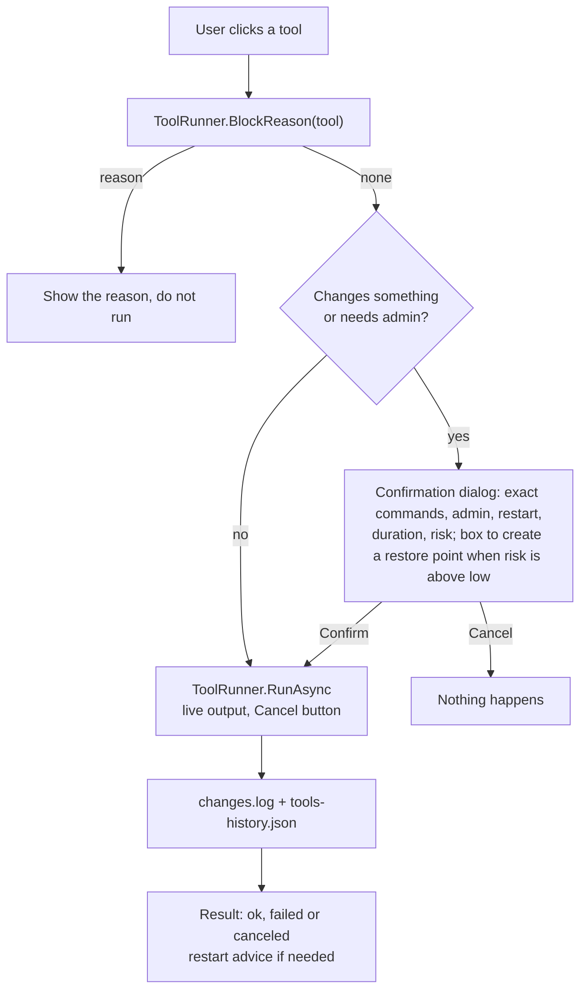

# Tools

The Tools tab (both profiles) holds one-click maintenance actions that are not simple switches: they run a fixed command and finish. Code is in `WinDiag.Core\Tools`; the view is `WinDiag.App\Views\ToolsView.cs`.

Optimizations and Tools are different on purpose:

| | Optimizations (`FixCatalog`) | Tools (`ToolCatalog`) |
|---|---|---|
| Nature | A setting that stays changed | An action that runs once |
| Undo | Yes, per item, from a snapshot | No (except through a restore point) |
| Record | Snapshot JSON and `changes.log` | `changes.log` and `tools-history.json` |
| Engine | `FixEngine` | `ToolRunner` |

## Overview

- `ToolDefinition` declares one tool: stable `Id`, `NameText` and `ExplainText` (pt, en), `Category`, `Scope`, `Risk`, `NeedsAdmin`, `NeedsRestart`, `ReadOnly`, `LongRunning` (shows Cancel), `HasOptions`, `DurationText` and `CommandLines`, the exact lines shown to the user (`Commands` resolves the language). It holds no logic to apply itself. `ToolOption` describes a selectable item (`Id`, `Label`, `Bytes`, `DefaultOn`, `Note`).
- `ToolCatalog` is the static list of definitions.
- `ToolRunner` runs them: `GetOptions` (selectable items, for example in disk cleanup), `BlockReason` (why a tool cannot run now), `RunAsync` (executes with live output and cancellation) and `History` (reads the history file).
- `DryRun` lists what would be executed and changes nothing.
- External commands have a timeout and no window. Long ones (`sfc`, `DISM`, `chkdsk`, `ipconfig`, `netsh`) stream their output through `Proc.RunStreaming`; `sc`, `rundll32` and the screens that only open a Windows tool use `Proc.Run` or a shell open.

## Flow

Read-only tools that need no administrator (connection test, battery report, memory diagnostic, shortcuts) run directly. The restore point is a box inside the confirmation, not a separate step.
The app never restarts the PC. When a tool needs a restart, it says so and leaves the decision to the user.

## Catalog

Categories (`ToolCategory`): Printing, Network, Cleanup, Gaming, Repair ("Windows repair"), Reports and Shortcuts. "Risk" is the value shown in the confirmation; the app offers a restore point before every tool whose risk is not low, except `RESTORE_POINT` itself.

| Id | Category | Admin | Restart | Risk | What it runs |
|---|---|---|---|---|---|
| `PRINT_UNSTICK` | Printing | Yes | No | Medium | `sc stop Spooler`, deletes the files in `%SystemRoot%\System32\spool\PRINTERS`, `sc start Spooler` and the dependent services that were running |
| `SPOOLER_RESTART` | Printing | Yes | No | Low | `sc stop Spooler` and `sc start Spooler` (with its dependents) |
| `PRINT_TEST_PAGE` | Printing | No | No | Low | `rundll32 printui.dll,PrintUIEntry /k /n "<default printer>"` |
| `NET_TEST` | Network | No | No | Low | 10 pings each to the gateway of the adapter that reaches the internet, `1.1.1.1` and `8.8.8.8` (.NET API) plus a DNS lookup; latency, jitter, loss and a verdict. Read-only |
| `NET_DNS_FLUSH` | Network | Yes | No | Low | `ipconfig /flushdns` |
| `NET_IP_RENEW` | Network | Yes | No | Low | `ipconfig /release` and `ipconfig /renew` |
| `NET_STACK_RESET` | Network | Yes | Yes | Medium | `netsh winsock reset` and `netsh int ip reset`. A static IP does not block it: the confirmation lists the IPs that would be erased and requires ticking "I understand" |
| `TIME_SYNC` | Network | Yes | No | Low | `sc start w32time` (only if stopped) and `w32tm /resync` |
| `DISK_CLEANUP` | Cleanup | No | No | Low | Deletes the items you tick, each shown with its size: user (`%TEMP%`) and Windows temporary files, Windows Update cache, Delivery Optimization cache, thumbnails, error reports (WER), Recycle Bin. Temporary files only when older than 24 hours, never the `%TEMP%\.net` folder. Each target is validated (never a drive root, the profile, Windows or Program Files) and no link or junction is followed. Three options clean only with administrator rights |
| `SHADER_CACHE_CLEAR` | Gaming | No | No | Low | Deletes the DirectX (`D3DSCache`), NVIDIA (`DXCache`, `GLCache`) and AMD (`DxCache`, `DxcCache`) shader caches under `%LOCALAPPDATA%` |
| `SYS_SFC` | Repair | Yes | No | Low | `sfc /scannow` |
| `SYS_DISM` | Repair | Yes | No | Medium | `DISM /Online /Cleanup-Image /RestoreHealth` |
| `SYS_CHKDSK` | Repair | Yes | No | Low | `chkdsk <system drive> /scan` (read-only) |
| `WU_RESET` | Repair | Yes | No | Medium | Stops `wuauserv`, `bits`, `cryptsvc` and `msiserver`, renames `SoftwareDistribution` and `catroot2` to `.old-<date>`, starts the services that were running |
| `EXPLORER_RESTART` | Repair | No | No | Low | Ends `explorer.exe` of your session and starts it again |
| `MEM_DIAG` | Repair | No | No | Low | Opens `mdsched.exe`. Windows asks about the restart; WinDiag schedules nothing |
| `RESTORE_POINT` | Repair | Yes | No | Low | WMI `SystemRestore.CreateRestorePoint`, named "WinDiag <date>" |
| `BATTERY_REPORT` | Reports | No | No | Low | `powercfg /batteryreport` to `%TEMP%` and opens the HTML |
| `OPEN_DEVMGMT` | Shortcuts | No | No | Low | `devmgmt.msc` |
| `OPEN_PRINTERS` | Shortcuts | No | No | Low | `ms-settings:printers` |
| `OPEN_APPS` | Shortcuts | No | No | Low | `ms-settings:appsfeatures` |
| `OPEN_WINUPDATE` | Shortcuts | No | No | Low | `ms-settings:windowsupdate` |
| `OPEN_DISKMGMT` | Shortcuts | No | No | Low | `diskmgmt.msc` |
| `OPEN_RELIABILITY` | Shortcuts | No | No | Low | `perfmon /rel` |

The columns come from `ToolCatalog.cs` (`NeedsAdmin`, `NeedsRestart`, `Risk`); `WinDiag.Cli --tools` prints the same flags. `NET_STACK_RESET` is the only tool that needs a restart to take full effect.
## Safety rules

- Commands are fixed in the code. The app does not write `.bat` files, does not download or run third-party code and does not generate scripts. Network use: `NET_TEST` (ping to `1.1.1.1` and `8.8.8.8` and one name lookup), `TIME_SYNC` and `SYS_DISM` use the internet when you run them.
- `BlockReason` is checked before the confirmation. Tools that change something or need administrator rights ask for confirmation; read-only tools without administrator run directly.
- The confirmation dialog shows exactly what will run, whether it needs administrator rights, whether it asks for a restart, the estimated duration and the risk.
- A blocked tool shows the reason and does not start.
- Output is shown live and the Cancel button stops the process.
- Every run is written to `changes.log` and to `%ProgramData%\WinDiagMaint\tools-history.json`.
- For tools whose risk is not low, the confirmation has a box to create a restore point first. Tools are not reversible except through that restore point.
- External processes use a timeout and no window.

## Different account

If WinDiag is opened with the credentials of another administrator (UAC asks for a different account), per-user cleanups and adjustments act on that account's profile, so they are unavailable. The same applies to the per-user options of disk cleanup. Run WinDiag from your own account to use them.

## How to add a tool

1. Add a `ToolDefinition` to `ToolCatalog.All` with a new stable `Id`, `NameText` and `ExplainText` (pt-BR with correct accents), `Category`, fixed `CommandLines` and the `NeedsAdmin`, `NeedsRestart` and `Risk` values. Shortcuts that only open a Windows screen use the `Shortcut(...)` helper.
2. Implement `BlockReason` for the cases where the tool must not run (for example, a service disabled on purpose). Return a plain-language reason.
3. If the tool has selectable items, expose them in `GetOptions` with their sizes.
4. Run commands through `Proc.Run` or `Proc.RunStreaming`, with a timeout and no window. Do not download, do not write scripts and do not restart the PC.
5. Make sure `DryRun` lists the exact commands and changes nothing.
6. Link a finding to the tool with `toolId:` in `res.Find`, when a check points to it (see [Analysis and rules](analysis-and-rules.md)).
7. Add the button to the matching category in `ToolsView`.
8. Add tests (below).

## Tests

- Catalog: unique ids, every tool has pt-BR and English texts, and every `ToolId` used by a finding or an action step exists.
- `DryRun`: lists the expected commands and changes nothing.
- `BlockReason`: each blocking case, including the no-data case.
- `History`: reads and writes `tools-history.json` in a temporary folder.
- CLI check: `--tools` lists the catalog and `--dry-tool ID` prints what a tool would run.
