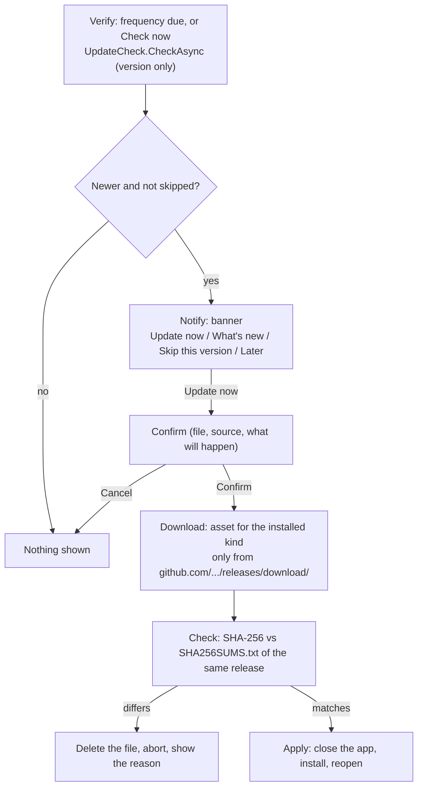

# Updates

WinDiag can check for a new version and update itself. Nothing is downloaded or installed without a click from the user. Code is in `WinDiag.Core\Update` (`UpdateCheck`, `UpdateInstaller`) and in the app (`MainWindow.Update.cs`, `Views\UpdateWindows.cs`, the Updates block of `Views\SettingsView.cs`). The installer script is `installer\WinDiag.iss`.

There is no telemetry. WinDiag does not download or run third-party code. This module is the only place that downloads anything; the network tools and DISM use the internet only when you run them (see [Tools](tools.md)).

## Overview

- `UpdateCheck.CheckAsync` does one GET to `https://api.github.com/repos/dougllascda/WinDiag/releases/latest` (User-Agent `WinDiag`, 8 s limit). It returns `UpdateInfo` (version, release page, notes, assets) or `null` on any failure. Drafts and pre-releases are ignored.
- The Core never calls it by itself. The app decides when, based on `UpdateFrequency`: `OnStartup`, `Daily`, `Weekly` (default), `Monthly` or `Manual`. `UpdateCheck.IsDue` compares with the last check (`LastUpdateCheckUtc`); `Manual` is never due.
- `UpdateInstaller` downloads, verifies and applies. Each step is called by the app after the user asks.
- Settings > Updates: frequency, "Last check" and "Check now".

## Flow



The "Update now" button is refused while a scan, an optimization, a tool or an export is running.

## Trust model

- **Source.** Only addresses that start exactly with `https://github.com/dougllascda/WinDiag/releases/download/` are accepted (`IsAllowedDownloadUrl`): https, host `github.com`, no `..` (also encoded), no backslash or control characters. The file and `SHA256SUMS.txt` must be from the same release folder.
- **File name.** The exact name for the installed kind: `WinDiag-Setup-<v>.exe`, `WinDiag-Portable-<v>.exe` or `WinDiag-<v>-fx.exe`. If the release lacks the file or `SHA256SUMS.txt`, nothing is downloaded and the update is refused.
- **Protected folder.** When the app is elevated, the file goes to `%ProgramData%\WinDiagMaint\update`, which only Administrators and SYSTEM can write; otherwise it falls back to `%LOCALAPPDATA%\WinDiag\update`.
- **Integrity.** The SHA-256 computed while downloading must match the line for that file in `SHA256SUMS.txt`. If it differs, the file is deleted and the update is aborted. The size limit is 400 MB and the reported size must match. The file is kept open read-only between the check and the execution, so it cannot be swapped in between.
- **Limit.** The executables are not code-signed yet. The SHA-256 check detects a corrupted or tampered download on the way, but it does not replace a signature: `SHA256SUMS.txt` comes from the same release, so it guarantees integrity, not authorship. For proof of origin, use `gh attestation verify` (see [SIGNING.md](../SIGNING.md)).

## Install kinds

`UpdateInstaller.DetectKind` chooses the file:

| Kind | Detected when | File | How it is applied |
|---|---|---|---|
| `Installer` | `unins000.exe` next to the executable | `WinDiag-Setup-<v>.exe` | Starts the installer with `/SILENT /SUPPRESSMSGBOXES /NORESTART /RELAUNCH=1`; the script reopens the app with `--updated` |
| `Portable` | Larger than 30 MB (self-contained; a heuristic) | `WinDiag-Portable-<v>.exe` | `SwapExecutable`: renames the running exe to `<name>.old`, moves the new one in, starts it with `--updated` |
| `FrameworkDependent` | Otherwise | `WinDiag-<v>-fx.exe` | Same swap as Portable |

If a step of the swap fails, everything is rolled back and the error is shown. On the next start, `CleanupLeftovers` deletes `<exe>.old` and old download folders. Downloads live in the protected folder above.

## CLI

```powershell
dotnet run --project app\WinDiag.Cli -- --check-update      # queries the latest version
dotnet run --project app\WinDiag.Cli -- --download-update   # downloads and verifies the file of the detected kind; does not apply
```

These are the only CLI commands that use the network, and only when you run them.

## Rules for releases

These names are a contract with the updater. The release must publish `SHA256SUMS.txt` and the three exact file names above, or the update is refused. See [RELEASING.md](../RELEASING.md).

## How to extend

- Keep the Core free of timers and automatic calls: scheduling belongs to the app.
- Any new download address must pass `IsAllowedDownloadUrl`. Do not widen the allowed prefix.
- A new install kind needs a new `InstallKind`, an `AssetNameFor` entry, a branch in `Apply` and the matching file in the release workflow.

## Tests

- `UpdateCheck.Parse` and `IsNewer` with valid, invalid, draft and pre-release JSON.
- `IsDue` for each frequency, including never checked.
- `IsAllowedDownloadUrl` with allowed and refused addresses.
- `ParseSums`, `AssetNameFor` and `DetectKind`.
- `DownloadAsync` with a fake HTTP handler and a temporary folder: matching hash, differing hash (file deleted), missing `SHA256SUMS.txt`, different release folder.
- `SwapExecutable` with `launch: false` and the rollback; `CleanupLeftovers`.
