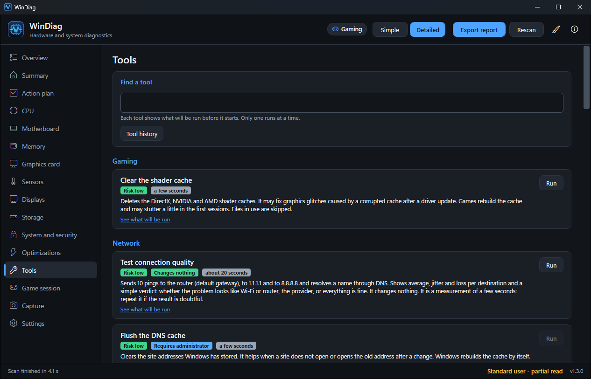

<p align="center">
  
</p>

<h1 align="center">WinDiag</h1>

<p align="center">
  Inventário de hardware, diagnóstico explicado e otimizações reversíveis para jogos no Windows 10/11.
</p>

<p align="center">
  <a href="../../README.md">English</a> | <b>Português (Brasil)</b>
</p>

<p align="center">
  <a href="https://github.com/dougllascda/WinDiag/releases/latest"></a>
  <a href="https://github.com/dougllascda/WinDiag/releases"></a>
  <a href="https://github.com/dougllascda/WinDiag/actions/workflows/ci.yml"></a>
  <a href="../../LICENSE"></a>
  
  
</p>

<p align="center">
  
</p>

<table>
  <tr>
    <td align="center"><br><sub>Ferramentas</sub></td>
    <td align="center"><br><sub>Otimizações</sub></td>
  </tr>
  <tr>
    <td align="center"><br><sub>Análise da plataforma</sub></td>
    <td align="center"><br><sub>Sensores</sub></td>
  </tr>
  <tr>
    <td align="center"><br><sub>Perfil Trabalho: visão geral</sub></td>
    <td align="center"><br><sub>Perfil Trabalho: impressoras e programas de fábrica</sub></td>
  </tr>
  <tr>
    <td align="center" colspan="2"><br><sub>Visão geral, tema claro</sub></td>
  </tr>
</table>

O WinDiag abre já lendo tudo, sem botão "detectar": processador, placa-mãe, memória, placa de vídeo, monitores, discos (com S.M.A.R.T.), virtualização, antivírus, inicialização e eventos. Cada achado vem com **o que significa** e **o que fazer**, e o Resumo ordena os **gargalos prováveis para jogos** pelo impacto.

## Destaques

- Inventário no estilo CPU-Z/GPU-Z, lido automaticamente ao abrir, com valores ao vivo a cada segundo.
- Análise da plataforma: onde está o limite e o que dá para melhorar, só com base em leituras medidas.
- Diagnóstico explicado: cada achado diz o que significa e o que fazer.
- Otimizações reversíveis: um interruptor por item, snapshot antes de cada alteração e desfazer só daquele item.
- Ferramentas de um clique: impressão, rede, limpeza e reparo do sistema, com os comandos exatos mostrados antes de você confirmar.
- Aba Sensores no estilo HWiNFO (atual, mín., máx., média), com alertas de temperatura, ventoinha, VRM e disco.
- Estimativa de fonte, com aviso se a fonte informada por você parecer fraca.
- Perfil de uso **Jogos | Trabalho**: o perfil Trabalho cobre impressoras, programas de fábrica (com recomendação e desinstalação pelo desinstalador oficial), bateria e energia de notebook, Windows Update e tempo de inicialização; as abas de jogo ficam ocultas no perfil Trabalho.
- Modo Simples (linguagem comum) e Detalhado; interface e relatórios em português do Brasil e inglês.
- Atualização do próprio app com verificação SHA-256, na frequência que você escolher (inclusive Manualmente).
- Sem telemetria, sem baixar nem executar código de terceiros e sem código gerado em runtime. O uso da internet se limita à verificação de atualizações (só o repositório oficial) e às ferramentas de rede e ao DISM quando você as executa.

Site da documentação: <https://dougllascda.github.io/WinDiag/>

## Download

Baixe a versão mais recente na [página de Releases](https://github.com/dougllascda/WinDiag/releases/latest).

| Arquivo | Para quem |
|---|---|
| `WinDiag-Setup-<versão>.exe` (**recomendado**) | Instalador: Menu Iniciar, ícone opcional, desinstalação pelo Windows |
| `WinDiag-Portable-<versão>.exe` | Portátil, sem instalar nada (runtime embutido) |
| `WinDiag-<versão>-fx.exe` | Pequeno; exige o [.NET 8 Desktop Runtime](https://dotnet.microsoft.com/download/dotnet/8.0) |

## Verifique o download

Compare o hash com o `SHA256SUMS.txt` do Release:

```powershell
Get-FileHash .\WinDiag-Setup-<versão>.exe -Algorithm SHA256
```

Confirme a procedência do build com o [GitHub CLI](https://cli.github.com/):

```powershell
gh attestation verify .\WinDiag-Setup-<versão>.exe --repo dougllascda/WinDiag
```

Mais detalhes em [docs/SIGNING.md](../SIGNING.md) (em inglês).

## Recursos

- **Análise da plataforma:** mostra onde está o limite do conjunto e o que dá para melhorar, sem afirmar causas que não foram medidas.
- **Resumo:** contagem OK/INFO/AVISO/ATENÇÃO, gargalos prováveis e todas as verificações.
- **CPU, Placa-mãe, Memória, Placa de vídeo, Monitores, Armazenamento, Sistema e segurança:** inventário com leituras ao vivo (clock por thread, carga, RAM, temperatura, potência, clocks e PCIe da GPU).
- **Sensores:** valores atual, mín., máx. e média. Lê do HWiNFO (com "Shared Memory Support" ativado) e da biblioteca LibreHardwareMonitor embutida.
- **Otimizações:** um interruptor por item. Ligar salva um snapshot antes; desligar restaura só aquele item. Itens já ajustados fora do WinDiag (ex.: AtlasOS) aparecem travados. O histórico de snapshots permite restaurar um snapshot inteiro.
- **Perfil de uso (Jogos | Trabalho):** Jogos mantém a análise voltada a jogos, a Sessão de jogo e a Captura. Trabalho mostra impressoras, programas de fábrica (recomendação e remoção pelo desinstalador oficial de cada programa), bateria e energia de notebook, Windows Update e tempo de inicialização, e oculta as abas de jogo.
- **Atualizações:** Configurações > Atualizações define a frequência da verificação (Ao abrir o app, Diariamente, Semanalmente, Mensalmente, Manualmente). Havendo versão nova, uma faixa oferece Atualizar agora, Novidades, Pular esta versão e Depois. "Atualizar agora" pede confirmação, baixa o arquivo do seu tipo de instalação, confere o SHA-256, fecha o app, instala e reabre.
- **Ferramentas:** manutenção de um clique (veja [Ferramentas](#ferramentas)). Cada ferramenta mostra os comandos exatos, pede confirmação e mantém um histórico.
- **Sessão de jogo:** lista os apps pesados em segundo plano e fecha só os que você marcar.
- **Captura:** mede CPU, GPU, DPC, disco, paginação e RAM a cada segundo enquanto você joga, identifica o processo do jogo pela carga 3D da GPU e resume com percentis (P50/P95/P99).
- **Configurações:** tema (Automático, Claro, Escuro), modo Simples/Detalhado, idioma, sua fonte, status dos sensores, pastas de dados e licenças.
- **Exportar relatório:** um único arquivo HTML (autocontido, claro/escuro, pronto para impressão) ou TXT, com nome de usuário e números de série mascarados.

## Ferramentas

A aba Ferramentas existe nos dois perfis. Os comandos são fixos no código: o WinDiag não grava arquivos `.bat`, não baixa código de terceiros e não gera scripts. Cada ferramenta mostra exatamente o que vai executar. As que alteram algo ou exigem administrador pedem confirmação antes; as somente leitura sem administrador (teste de conexão, relatório de bateria, diagnóstico de memória, atalhos) rodam direto. A saída aparece ao vivo, com botão Cancelar. O WinDiag nunca reinicia o PC.

| Categoria | Ferramenta | O que faz | Admin | Reinício |
|---|---|---|---|---|
| Impressão | Destravar fila de impressão | Para o spooler, apaga os trabalhos pendentes e o religa | Sim | Não |
| Impressão | Reiniciar spooler / Página de teste | Reinicia o serviço / imprime a página de teste do Windows | Sim / Não | Não |
| Rede | Teste de rede | Faz ping no gateway do adaptador que sai para a internet, em 1.1.1.1 e em 8.8.8.8, e uma resolução de nome; mostra latência, jitter, perda e um veredito. Não altera nada | Não | Não |
| Rede | Limpar DNS / Renovar IP / Sincronizar hora | `ipconfig /flushdns`, `ipconfig /renew`, `w32tm /resync` | Sim | Não |
| Rede | Redefinir pilha de rede | `netsh winsock reset` e `netsh int ip reset`. A confirmação lista os IPs fixos que seriam apagados e exige marcar "Estou ciente" | Sim | Sim |
| Limpeza | Limpeza de disco | Temporários, caches do Windows Update e da Otimização de Entrega, miniaturas, relatórios de erro, lixeira. Você escolhe os itens e vê os tamanhos | Não | Não |
| Jogos | Cache de shaders | Limpa os caches de shaders do DirectX, NVIDIA e AMD | Não | Não |
| Reparo | SFC / DISM / CHKDSK | `sfc /scannow`, `DISM /Online /Cleanup-Image /RestoreHealth`, `chkdsk /scan` (só leitura) | Sim | Não |
| Reparo | Redefinir Windows Update | Para os serviços, renomeia `SoftwareDistribution` e `catroot2`, religa os serviços | Sim | Não |
| Reparo | Reiniciar Explorer / Diagnóstico de memória | Reinicia o shell / abre o Diagnóstico de Memória do Windows (o Windows pergunta sobre o reinício) | Não | Não |
| Reparo | Ponto de restauração | Cria um ponto de restauração | Sim | Não |
| Relatórios | Relatório de bateria | `powercfg /batteryreport`, aberto no navegador | Não | Não |
| Atalhos | Gerenciador de Dispositivos, impressoras, aplicativos, Windows Update, Gerenciamento de Disco, Monitor de Confiabilidade | Abrem a ferramenta correspondente do Windows | Não | Não |

As ferramentas não são reversíveis, exceto por ponto de restauração, que o WinDiag oferece antes de toda ferramenta de risco não baixo (destravar impressão, redefinir pilha de rede, DISM, redefinir Windows Update). Detalhes: [docs/modules/tools.md](../modules/tools.md) (em inglês).

## Segurança

**Lê, sem alterar nada:** WMI/CIM, registro, contadores de desempenho, `nvidia-smi --query`, `powercfg /query`, `bcdedit /enum`, `fltmc filters`, `fsutil behavior query` e logs de eventos.

**As otimizações alteram algo só quando você liga um interruptor e confirma:**

| Item | Mudança |
|---|---|
| Game DVR | `GameDVR_Enabled` / `AppCaptureEnabled` = 0 |
| HAGS | `HwSchMode` = 2 |
| Compressão de memória | `Enable-MMAgent` / `Disable-MMAgent -MemoryCompression` |
| Otimizações para jogos em janela | `SwapEffectUpgradeEnable=1` em `DirectXUserGlobalSettings` (demais opções preservadas) |
| Suspensão seletiva de USB / ASPM | `powercfg /setacvalueindex` (na tomada) |
| Modo de Jogo | `AutoGameModeEnabled` = 1 |
| Apps na inicialização | `StartupApproved` (mesmo mecanismo do Gerenciador de Tarefas) |
| SysMain / Windows Search | tipo de inicialização do serviço |
| Hibernação | `powercfg /hibernate off` |
| Integridade de Memória (HVCI) | `HypervisorEnforcedCodeIntegrity\Enabled` = 0 |
| Hypervisor (risco alto) | `bcdedit /set hypervisorlaunchtype off` |
| HPET forçado | `bcdedit /deletevalue useplatformclock` |
| MPO (experimental) | `Dwm\OverlayTestMode` = 5 |
| Aceleração do mouse | desliga "Aprimorar precisão do ponteiro" (Jogos) |
| Teclas de Aderência/Filtro/Alternância | desliga os atalhos de teclado que as abrem (Jogos) |
| Plano de energia (Jogos, só PC de mesa) | muda para Alto desempenho, se esse plano existir |
| Travar impressora padrão (perfil Trabalho) | impede o Windows de trocar a impressora padrão |
| Plano de energia (perfil Trabalho) | PC de mesa em Economia de energia → Alto desempenho; notebook em Alto/Máximo desempenho → Equilibrado (reversível; só se o plano alvo existir) |
| Desinstalar programas de fábrica | abre o desinstalador oficial do próprio programa; nunca silencioso, nunca automático (não reversível) |

- Itens de risco alto pedem para digitar `CONFIRMO` antes de serem aplicados.
- As otimizações salvam um snapshot JSON do estado anterior em `%ProgramData%\WinDiagMaint\snapshots\` antes de serem aplicadas; o histórico fica em `changes.log`. Desligar o interruptor, ou restaurar um snapshot, volta ao valor salvo.
- As ferramentas não geram snapshot. Mostram os comandos que vão executar, pedem confirmação quando alteram algo ou exigem administrador, registram cada execução em `changes.log` e em `%ProgramData%\WinDiagMaint\tools-history.json`, e oferecem um ponto de restauração antes de toda ferramenta de risco não baixo. A desinstalação de programas de fábrica também não é reversível e sempre pede confirmação.
- Sem telemetria. O WinDiag não baixa nem executa código de terceiros. A verificação de atualizações (frequência configurável, padrão semanal, pode ser Manual) consulta apenas o repositório oficial; o download e a instalação só acontecem com o seu clique, com o arquivo conferido por SHA-256. As ferramentas de rede (teste de conexão: ping em 1.1.1.1 e 8.8.8.8 e uma resolução de nome; sincronizar relógio) e o DISM usam a internet quando você as executa. As opções ficam em Configurações > Atualizações (Ao abrir o app, Diariamente, Semanalmente, Mensalmente ou Manualmente). O arquivo baixado é conferido com o `SHA256SUMS.txt` do mesmo release. Os executáveis ainda não têm assinatura de código; por isso a conferência prova integridade, não autoria (veja [docs/modules/updates.md](../modules/updates.md), em inglês).
- Sem ofuscação, empacotador nem código gerado em tempo de execução. As chamadas nativas se limitam a APIs documentadas do Win32.
- O ganho varia por PC e por jogo, e as otimizações são opcionais. Mais em [SECURITY.pt-BR.md](SECURITY.pt-BR.md).

## Perguntas frequentes

**O SmartScreen do Windows avisa sobre o arquivo.**
Os executáveis ainda não têm assinatura de código, então o SmartScreen pode exibir um aviso. Escolha "Mais informações" > "Executar assim mesmo" depois de conferir o hash SHA256 e o atestado de build (veja [Verifique o download](#verifique-o-download)).

**Por que ele pede administrador?**
S.M.A.R.T., BCD, minifiltros do sistema de arquivos e as otimizações exigem esse acesso. Sem ele, o app abre mesmo assim e marca as leituras afetadas como parciais ("exige administrador").

**Meu antivírus acusou o arquivo.**
O executável não é assinado e, quando você liga as otimizações, altera configurações do sistema (registro, BCD, energia) e executa comandos de manutenção. Alguns antivírus podem desconfiar disso. Abra uma issue com o nome da detecção e a versão.

**A temperatura da CPU não aparece.**
O Windows não expõe o sensor do núcleo sem um driver de terceiros. Abra o HWiNFO com **Shared Memory Support** ativado, ou instale o driver PawnIO pelo site oficial para que a biblioteca LibreHardwareMonitor embutida consiga ler. O WinDiag não inclui, não baixa nem instala esse driver.

**A fonte de alimentação não é detectada.**
Na maioria dos sistemas, software não consegue detectar a fonte. Informe-a em **Configurações** e o app a compara com o consumo de pico estimado. Fontes digitais Corsair/NZXT podem ser detectadas por USB.

**Quais idiomas são suportados?**
Português do Brasil e inglês. A opção automática segue o Windows e pode ser trocada em Configurações; números e datas acompanham o idioma.

O WinDiag não mede tempo de quadro nem aponta qual driver causa latência DPC; para isso, use PresentMon/CapFrameX e LatencyMon.

## Compilar

Requer o [.NET 8 SDK](https://dotnet.microsoft.com/download/dotnet/8.0).

Compilar o código-fonte é permitido apenas para avaliação e para preparar contribuições (veja o [LICENSE](../../LICENSE)); os binários gerados não podem ser distribuídos.

```powershell
dotnet build app\WinDiag.sln -c Debug
dotnet test app\WinDiag.sln
pwsh -File tools\publish.ps1 -Scan   # gera dist\ e, se houver Kaspersky, faz uma varredura
```

- `app\WinDiag.Core`: coletores, regras, motor de otimizações e relatório.
- `app\WinDiag.App`: interface WPF.
- `app\WinDiag.Cli`: ferramenta de teste sem interface (`--dump`, `--live`, `--fixes`, `--dry-enable`, `--dry-disable`, `--tools`, `--dry-tool`).
- `app\WinDiag.Tests`: testes xUnit.
- [`docs\ARCHITECTURE.md`](../ARCHITECTURE.md): visão geral da arquitetura (em inglês).

## Contribuindo

Issues e sugestões são bem-vindas, em português ou inglês. Pull requests só são aceitos sob o Contrato de Licença de Contribuidor (CLA) descrito em [CONTRIBUTING.pt-BR.md](CONTRIBUTING.pt-BR.md) (versão em inglês: [.github/CONTRIBUTING.md](../../.github/CONTRIBUTING.md)). Para relatar uma vulnerabilidade, veja [SECURITY.pt-BR.md](SECURITY.pt-BR.md).

## Licença

Código visível, não é código aberto ("source-available"): você pode usar as versões oficiais gratuitamente em computadores próprios ou que esteja autorizado a administrar, inclusive prestando suporte técnico a terceiros, desde que não redistribua, revenda nem cobre pelo software em si; copiar, modificar, redistribuir ou vender o código ou os binários não é permitido sem autorização por escrito. © 2026 dougllascda. Veja [LICENSE](../../LICENSE) (tradução informativa: [LICENSE.pt-BR.md](LICENSE.pt-BR.md)). Componentes de terceiros e suas licenças: [THIRD-PARTY-NOTICES.md](../../THIRD-PARTY-NOTICES.md).
